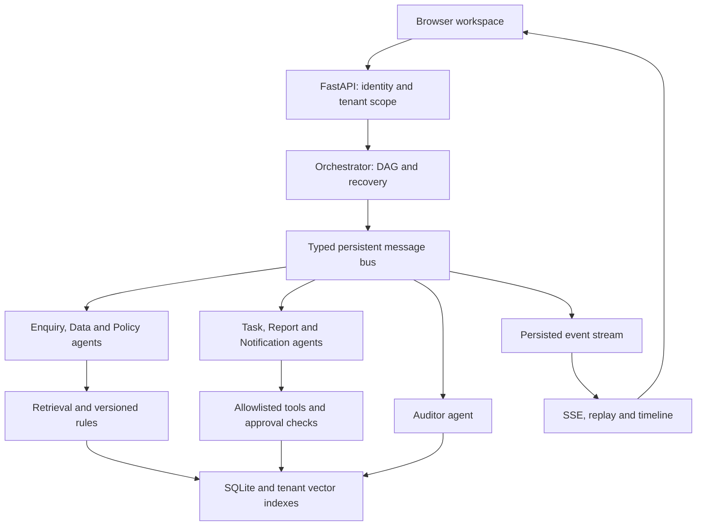
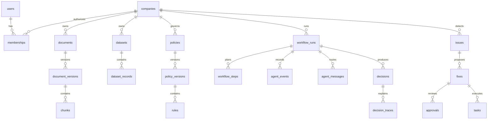

# OrchestraAI — Phase 1 review and proposed architecture

Academic title: **Design and Development of a Multi-Agent AI System for Intelligent Business Workflow Automation**

Prepared for Harsh Saini, 20 October 2026. Status: architecture approved by the user’s instruction to continue. Phase 2 implemented; see phase2-verification.md. Code publication has not occurred.

## 1. Evidence and baseline

The connected GitHub account is `harshsaini-dev`. GitHub reports `harshsaini-dev/agentflow-rag` as an empty public repository, with push access. The existing repository was not changed. Subsequently, at the user's explicit request, the empty private repository `harshsaini-dev/orchestra-ai` was created through GitHub's website. No files or commits were uploaded.

The attached brief was read locally. The exact Week 2 archive was not found in the targeted search. A newer archive, `AgentFlow_RAG_DeployReady_v0.7.1.zip`, was found and inspected. Its README calls the application milestone v0.7.0; the archive filename is v0.7.1. This is the proposed extension baseline, subject to your architecture approval.

Local verification: Python 3.12, isolated virtual environment, installed the archive's `requirements-dev.txt`, and ran `python -m pytest -q`: **75 passed, 1 skipped, 1 warning in 7.16 seconds**. The optional RAG test module was skipped because its dependencies were not installed. The warning concerns Starlette's deprecated httpx TestClient integration. Syntax parsing also passed for all 16 application, test and script Python files. No live provider call or browser verification was performed in this review. The README's earlier claim of 87 tests is historical, not this review's result.

| Area | Inspected existing implementation | Proposed change |
|---|---|---|
| Agent roles (O1) | Planner, Data, Policy retrieval, Decision and Action classes | Split modules; add Enquiry, Task, Report, Notification and Auditor handlers |
| Orchestration (O2) | Direct component calls, bounded worker queue, persisted jobs | Typed message bus, persistent DAG steps, bounded recovery |
| Live UI (O1/O2) | SSE events, agent inspector, event cursor and replay | Retain SSE; graph packets, explicit agent states and timeline |
| Data (O3) | Eight synthetic orders; sqlite3 persistence | SQLAlchemy migration, company ownership, structured uploads and profiling |
| Retrieval (O3) | BM25 policy search; optional Gemini embeddings and Chroma | Offline document retrieval; heading-aware chunks, hybrid fusion, reranking |
| Governance (O4) | Approval transaction, stale-state checks, duplicate-refund prevention | Preserve protections; authenticated roles, policy versions and audit chain |
| Policies (O4) | Curated JSON plus deterministic order rules | Structured rule drafts, publication, evidence links, simulator and conflicts |
| Evaluation (O5) | Regression tests and operational counts | Golden datasets and measured quality, latency, retry and compliance metrics |

## 2. Repository decision

Use **one new modular repository**, proposed name `harshsaini-dev/orchestra-ai`, initially private, with **OrchestraAI** as the product name. The user explicitly requested a new repository after the baseline review. FastAPI serves the plain JavaScript frontend. One repository keeps API changes, tests, documentation and frontend behavior versioned together. Separate repositories would add coordination without a current deployment need.

Preserve the original baseline locally, establish its history when implementation is approved, and make small phase commits locally. Creation of the empty new repository is authorized. Do not upload project files or push commits until a separate GitHub approval. Before publication, present the exact repository, visibility, branch, commit summary, diff statistics, test results and limitations.

## 3. Proposed architecture



Agent-to-agent work crosses the bus with a typed envelope. Agents may call bounded service/tool adapters, emitting tool events; they may not silently invoke other agents. The UI graph consumes actual events, rather than a separately timed simulation. Presentation delays are optional and excluded from compute latency.

SSE is retained because the existing code supports it and commands can travel over HTTP. Add monotonic per-run event sequence numbers, authorized reconnect cursors, heartbeats and replay. Use a bounded single-process worker pool for the SQLite milestone; multiple Uvicorn workers are unsupported until the queue is externalized.

Agent states are explicit transitions, not one fixed linear chain: idle → thinking; thinking → retrieving or working; working → waiting_approval or done; active states → error; recoverable errors → recovering → thinking. Terminal failures remain failed. Approval resume is persisted, with execution eligibility rechecked in the mutation transaction.

### Repository layout

```text
agentflow-rag/
  app/
    main.py
    core/                 # configuration, auth, LLM interface, events, bus
    agents/               # base state machine, orchestrator, specialized handlers
    workflows/            # typed DAG definitions and durable step execution
    tools/                # permitted reads and approval-gated mutations
    api/                  # routes, schemas, dependencies, SSE
    db/                   # SQLAlchemy models, sessions, repositories
    data/                 # ingestion, profiling, synthetic company generator
    rag/                  # loaders, chunks, guard, embeddings, store, retrieval
    policy/               # compiler, rule engine, versions, conflicts, simulator
    issues/               # detectors, fix proposals, verification
    reports/              # templates and PDF rendering
    evaluation/           # golden cases, measured metrics, exports
  frontend/
    index.html
    css/
    js/                   # graph, feed, timeline, policies, issues, chat, etc.
  migrations/             # Alembic schema and baseline import migrations
  tests/
    unit/
    integration/
    e2e/
    fixtures/
  scripts/                # setup, demo, evaluation and migration utilities
  docs/                   # architecture, API, demo, 30 viva Q&As, measured results
  .github/workflows/      # test and quality CI
  requirements.txt
  requirements-dev.txt
  requirements-local-ai.txt
  .env.example
  .gitignore
  pyproject.toml
  Dockerfile
  compose.yaml
  README.md
  SECURITY.md
```

No real `.env`, runtime databases, uploaded business files, embeddings, virtual environments or caches will enter Git. Sample data is synthetic and generated from a recorded seed and reference date.

## 4. Data model

All company-owned tables carry `company_id`; foreign keys and uniqueness include tenant scope where appropriate. The server verifies membership rather than trusting a company ID supplied by the browser.



| Table group | Main fields and constraints |
|---|---|
| companies, users, memberships, sessions | Workspace settings, password hashes, company role, expiring session hashes; unique membership per user/company |
| documents, document_versions, chunks | Filename, content hash, version, page/section, ordinal, extraction status, injection flags; immutable source versions |
| datasets, dataset_records | Schema, source file, profile, validated JSON records; recognized business datasets additionally map into typed tables |
| customers, orders, sales, inventory, invoices, refunds, expenses, leave_requests, support_tickets | Typed business fields, dataset provenance, record version; currency stored as integer paise |
| policies, policy_versions, rules | Draft/published/superseded state, effective dates, priority, enabled state, validated operator, conditions and source chunk references |
| workflow_runs, workflow_steps | Objective IDs, DAG dependencies, status, attempt count, input/output references, idempotency key, timestamps |
| agent_messages, agent_events | Typed payload, tenant, run, trace, step and sequence; unique message ID and event sequence |
| decisions, decision_traces | Input snapshot, rule version IDs, matched clauses, outcome, reasoning, evidence and deterministic verification status |
| issues, fixes, approvals, tasks | Evidence, severity, proposed mutation, edit version, review actor/role, result, verification; approval binds to proposal hash |
| reports, notifications, schedules | Versioned report data, export location, delivery mode/status, schedule timezone, next run and deduplication key |
| audit_log, eval_runs | Canonical payload, previous hash, entry hash; evaluation dataset version, configuration, measured metrics and timings |

Back up existing SQLite files before migration. Import existing orders, workflows, approvals and historical events into a default legacy company with provenance. Preserve historical policy fingerprints. Do not invent old message-bus events or retrospectively claim historical entries were hash-chained at creation.

## 5. Message and event contracts

```json
{
  "schema_version": 1,
  "id": "uuid",
  "company_id": "uuid",
  "run_id": "uuid",
  "step_id": "uuid",
  "from": "orchestrator",
  "to": "policy",
  "type": "evaluate_refund",
  "payload": {"refund_id": "uuid", "policy_version_id": "uuid"},
  "trace_id": "uuid",
  "causation_id": null,
  "ts": "2026-10-20T03:18:25Z"
}
```

Persist the message before dispatch. Each event adds `event_id`, `sequence`, `event_type`, `agent`, `attempt` and a validated `payload`. Event types include `agent_state_changed`, `message_sent`, `tool_called`, `retrieval_done`, `approval_requested`, `step_completed`, `error`, `recovery_started`, and `run_completed`. Payloads exclude credentials and redact sensitive data for the caller's role. Store business mutation, audit entry and outgoing delivery intent atomically; consumers use idempotency keys to tolerate repeated delivery.

## 6. API surface

Proposed prefix: `/api/v1`. All company routes below are under `/companies/{company_id}` and require authorized membership. OpenAPI will describe complete request and response schemas during implementation.

| Method | Route suffix | Purpose |
|---|---|---|
| POST | `/auth/login`, `/auth/logout` (outside company prefix) | Session management |
| GET | `/auth/me` (outside company prefix) | Identity and memberships |
| GET/POST | `/companies` (outside company prefix) | List/create authorized workspaces |
| GET | `/dashboard` | Health drivers, issues, decisions and recent runs |
| POST | `/demo` | Seed synthetic company idempotently |
| POST | `/uploads` | Bounded multipart upload; return ingestion job |
| GET | `/datasets`, `/datasets/{id}` | Profiles, schema and paginated record preview |
| GET | `/documents`, `/documents/{id}/chunks` | Document versions and scoped source excerpts |
| DELETE | `/documents/{id}` | Authorized deletion and index invalidation |
| POST | `/documents/{id}/reindex`, `/retrieval/inspect`, `/chat` | Index, inspect and answer with citations |
| GET/POST | `/policies`, `/policies/{id}/versions` | Policies and version drafts |
| PATCH | `/policies/{id}/versions/{version_id}` | Edit an unpublished draft |
| POST | `/policies/{id}/versions/{version_id}/publish` | Authorize and activate validated rules |
| POST | `/policies/simulate` | Historical decision comparison without mutation |
| GET | `/issues`, `/issues/{id}`, `/decisions/{id}` | Evidence and decision traces |
| POST | `/issues/scan`, `/issues/{id}/fixes` | Detect issues and propose fixes |
| PATCH | `/fixes/{id}` | Edit draft fix; invalidate prior approval |
| POST | `/fixes/{id}/review`, `/fixes/{id}/execute` | Review then execute with role/version checks |
| POST/GET | `/runs` | Start a workflow or list history |
| GET | `/runs/{id}`, `/runs/{id}/events` | Snapshot and reconnectable SSE |
| POST | `/runs/{id}/cancel`, `/runs/{id}/resume` | Safe cancellation or authorized continuation |
| GET | `/reports`, `/reports/{id}`, `/reports/{id}/pdf` | Persisted HTML/PDF reports |
| GET/POST | `/schedules` | List/create scheduled workflows |
| PATCH/DELETE | `/schedules/{id}` | Change or remove a schedule |
| GET | `/notifications`, `/audit` | Outbox and paginated audit records |
| POST | `/audit/verify`, `/evaluations` | Verify integrity or run evaluation |
| GET | `/evaluations/{id}`, `/evaluations/{id}/export` | Measured results and export |
| GET/PATCH | `/settings` | Role-controlled settings; never return secrets |

Creation and mutation endpoints use bounded payloads, idempotency keys where applicable and optimistic version checks. Errors use stable codes plus a trace ID. SQL queries are parameterized and analytical query intents are allowlisted; model text never becomes executable SQL.

## 7. Retrieval, policy and autonomy decisions

- Retain **ChromaDB** for optional dense retrieval because it already exists in the baseline. SQL remains the authoritative source of document/version ownership. Dense indexes are company- and model-specific; revalidate retrieved IDs against authorized active chunks.
- The default small installation uses **BM25 + TF-IDF**, reciprocal rank fusion and lexical reranking. It performs real local retrieval and returns extractive/template answers with source citations. TF-IDF is lexical, not semantic dense embedding; the UI must label the active method honestly.
- Optional local sentence-transformers enables dense retrieval; an optional local cross-encoder enables reranking. Both require model downloads and more RAM. Demo mode must run without them or any provider key. Provider adapters for Gemini, OpenAI and Ollama share one `LLMClient`; generation cannot authorize actions.
- Heading/paragraph-aware chunks retain document version, section, page and overlap. Abstention thresholds must be calibrated against golden questions and negative cases. RRF scores are ranking scores, not probabilities.
- Natural-language policy parsing produces **draft rules** with supported grammar and clause citations. Ambiguous clauses require review; arbitrary legal/business language cannot be reliably compiled automatically. Only a published validated version governs actions.
- What-if uses identical historical input snapshots, reference time and rule engine for baseline and candidate. It changes no active policy or business record. Report approval requirement changes, affected amounts and customers; do not call the amounts realized savings.
- Prompt-injection patterns are flagged and quarantined for review. A detector is not a complete defense: uploaded text cannot grant tools, publish policies or alter authorization.
- Manual is the default autonomy setting. Assisted prepares actions for review. Autopilot can only execute explicitly allowlisted low-risk operations. High-risk monetary actions remain approval-gated. Refunds, purchase orders and WhatsApp-style messages are simulations unless a real integration is separately configured and authorized.
- A fix only closes after the Auditor verifies its postcondition. Creating a purchase-order draft does not mean physical inventory has been replenished. Health scores change only when their underlying measurements change; the score is an explained heuristic, not a validated business-risk rating.

## 8. Phases and gates

| Phase | Runnable outcome | Required verification |
|---|---|---|
| 1 | This baseline review and architecture | Architecture approval |
| 2 | Modular baseline, typed bus, agent states, live graph | Preserve order safeguards; reconnect/replay; message and state tests |
| 3 | SQLAlchemy migration, tenant scopes, basic authenticated membership, data upload and demo company | Migration rollback/backup; cross-tenant rejection; bounded upload/profiling tests |
| 4 | Offline RAG, knowledge UI, inspector, Enquiry and citation Auditor | Chunk metadata; retrieval positives/negatives; citation ownership; injection fixtures |
| 5 | Policy drafts, versions, compiler, decision traces and studio | Deterministic boundaries; source references; conflict priority; publish permissions |
| 6 | Issue detector, review/edit/reject/execute, simulator | Stale/duplicate approvals; transaction rollback; what-if non-mutation; verified fixes |
| 7 | Reports, outbox, scheduling, complete roles and hash-chain audit | Role enforcement; duplicate job prevention; PDF output; audit tamper detection |
| 8 | Evaluation, richer replay, chaos recovery, command palette and UI polish | Held-out metrics; bounded retry; accessible responsive flow; core coverage target ≥70% |
| 9 | Docker, clean setup, final docs and demonstration | Fresh-environment setup; five workflow acceptance checks; secret/artifact scan |

Minimal identity and tenant authorization move into Phase 3 because company isolation cannot safely wait until Phase 7. Full approval roles and administrative UI still land in Phase 7. Demo anomalies may be seeded in Phase 3, with automatic policy-based issue detection completed in Phase 6.

After architecture approval, each phase will be built and tested before advancing, with a runnable checkpoint and exact PowerShell commands. Failed gates are fixed or reported explicitly. The final push is a separate approval, as requested.

First five workflows: Weekly Sales Report (Data → Report → Auditor → Notification); Refund Decision (Policy → approval → Task → Auditor → Notification); Inventory Reorder (Data → Policy → draft task → approval); Policy Change Impact (Simulator → Report → explicit publication); Document Q&A (Enquiry → citation Auditor).

## 9. Risks and scope boundaries

1. SQLite and a local queue fit a small academic/portfolio deployment, not high-write distributed SaaS. Keep transactions short and use a single service process initially.
2. Multi-tenancy must cover queries, uploads, chunks, indexes, events, reports, audit and caches. Test denied cross-company access, including guessed object IDs and SSE cursors.
3. A database hash chain can reveal changes relative to a trusted head; an attacker controlling the entire database could rewrite the chain. External signed checkpoints are future work, not a current tamper-proof claim.
4. Retry only safe/idempotent work. Never repeat refunds or external notifications merely because an acknowledgment was lost. Interrupted mutating steps require reconciliation.
5. Dense retrieval and reranking can exceed low-memory hardware budgets. The lightweight path stays first-class; heavy models are lazy-loaded and optional.
6. No OCR in the initial loader scope: scanned PDFs must return a clear unsupported-content message. Limit archive expansion for XLSX/DOCX and reject encrypted/malformed uploads.
7. Numeric checks and exact source quotations do not establish semantic faithfulness for arbitrary generated prose. Report citation validity and human-reviewed faithfulness separately.
8. The brief is a substantial multi-phase product. No percentage-complete, production-ready, speedup or accuracy claims will be fabricated. Resume bullets will use only recorded measurements.

## 10. Approval requested

Approve extending the inspected AgentFlow v0.7.1 archive into OrchestraAI using this modular FastAPI/SQLite architecture and the new `harshsaini-dev/orchestra-ai` repository as the proposed publication destination. This approves local implementation only. GitHub publication still requires your separate approval of the finished diff and validation results.
