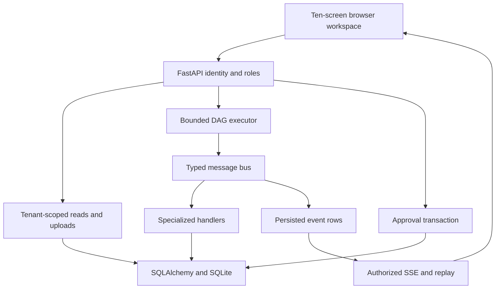
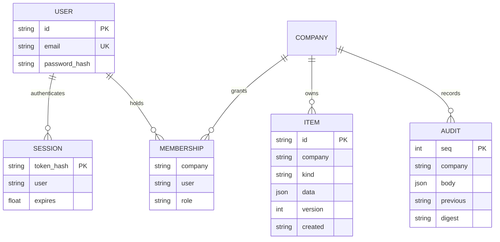

# Implemented architecture — OrchestraAI 1.0

The Phase 1 proposal is retained in `architecture-proposal.md`. This file describes the delivered implementation, including the decisions that differ from that proposal.

## Runtime boundaries

One Uvicorn process owns two workflow threads, ten outstanding execution slots and a re-entrant transaction lock. SQLAlchemy handles the new authenticated workspace catalog. SQLite uses WAL and a 30-second connection timeout. This is a local executor, not a distributed broker.

The old order workflow, typed bus and trace implementation are preserved. The new executor imports the same bus/state machinery and extends it with eight role identities. Legacy `/api/*` business endpoints are closed by default. This keeps the original testable behavior without exposing its unauthenticated approvals to new workspaces.

## Data model

Relationships above are conceptual; membership uniqueness and item identifiers have database constraints, while ownership relationships are enforced in the repository and API. Every object lookup includes company scope resolved through membership. Roles are never accepted from the client as an authorization assertion.

`ITEM.kind` distinguishes dataset, document, document_revision, policy, policy_revision, issue, run, event, report, notification, draft, schedule, config and evaluation. Structured record arrays and chunks use SQLite JSON through SQLAlchemy. This avoids a schema migration for every uploaded CSV, at the cost of whole-dataset JSON updates and limited analytical scale. It is not a normalized enterprise warehouse.

The v1 schema is created additively in `workspace.db`. The previous `agentflow.db` is retained; there is no destructive migration and no claim that old orders were silently imported into a company. SQLite files and provider caches are excluded from source delivery.

## Agent contracts and DAGs

`AgentMessage` is a frozen, extra-fields-forbidden Pydantic envelope with `schema_version`, `id`, `from`, `to`, `type`, JSON `payload`, `trace_id`, `step_id`, `causation_id` and UTC `ts`. Requests validate against the registered handler's model before dispatch. The event sink persists a request before invoking the handler. Replies carry the request ID as causation.

| Workflow | Ordered dependencies |
|---|---|
| Weekly report | Data → Report → Auditor → Notification |
| Document Q&A | Enquiry → Auditor |
| Issue scan | Data → Policy → Task → Auditor |
| Refund proposal | Data → Policy → Task → Auditor |
| Inventory proposal | Data → Policy → Task → Auditor |
| Policy impact | Data → Policy → Report → Auditor → Notification |

The Orchestrator selects only these DAGs. No model chooses SQL, code, recipients or arbitrary tools. The Data agent returns aggregate evidence; the executor retains scoped rows internally for downstream computation. Task produces proposals. Mutating approval is a separate synchronous API transaction with membership, source/policy/dataset version checks and postconditions. Proposal runs finish before review; the Issues screen retains pending decisions. The legacy engine additionally demonstrates an explicit `waiting_approval` state in its original workflow.

The state machine supports idle, thinking, retrieving, working, waiting_approval, done, error, recovering and cancelled. A deterministic fail-once Data fault produces a real error event followed by recovering → thinking and one successful read retry. No mutation is automatically retried. Startup marks queued/running workspace jobs interrupted; events remain available.

## Retrieval path

Extract text with file-specific loaders → retain genuine PDF page numbers or section references → split by headings into 220-word chunks with a 180-word stride → score BM25 and TF-IDF cosine → fuse ranks using `1/(60 + rank)` → add lexical overlap reranking → discard phrase-flagged or low-overlap passages from answers → return exact extracts with references.

SQLite active document versions are authoritative. The optional Chroma adapter uses a hash-derived collection per company, IDs containing document/version/chunk, removes stale IDs and embeds with a locally installed SentenceTransformer. It never downloads models implicitly. Failure falls back to lexical retrieval with a visible warning. The fallback is lexical, not semantic embedding search.

Optional provider output is a separately labeled summary draft. Exact cited extracts remain the main answer. The LLM interface has no write tools. Prompt-injection phrase detection is heuristic; the stronger boundary is that documents and generated text cannot authorize execution.

## Rule and approval lifecycle

Document upload/edit → review supported clause draft → change structured values → compare impacts → Owner publication → detect conditions → Manager/Owner review → transaction-local action and postcondition → audit evidence.

Executable rule values are separate from reference prose. The conservative parser detects a handful of refund, discount, inventory, overdue and leave patterns, reports unsupported fields and flags multiple distinct values for the same supported field. It does not understand arbitrary exceptions. Existing rules retain their explicit priority; publication uses optimistic version checks and preserves the previous snapshot.

Before execution, an issue must match the current dataset version, governing policy identity/version and policy source document version. Repeat review with the same issue version returns the recorded result. Changes to sibling records invalidate older dataset proposals; rerun the scan to refresh them. This intentionally favors clear approval evidence over permissive stale execution.

The Auditor's transaction-local postcondition prevents closing a condition merely because a tool returned successfully. A duplicate must actually be removed, whitespace must actually be trimmed, the new discount must pass the rule, or the simulated refund must have approved status. PO drafts and escalations create mitigation records and leave the condition open. Missing values/outliers require informed review rather than invented fixes.

## UI and accessibility

The final UI is vanilla ES modules with no build dependency. The sign-in sculpture uses actual CSS 3D faces; the operational network uses extruded isometric SVG nodes and CSS perspective. Packet animations correspond to recorded request/reply messages. Replay consumes persisted events and does not invoke mutation endpoints. Reduced-motion preference suppresses animations. Nodes are keyboard accessible; visible focus, semantic forms, a skip link, dialogs and status announcements are included.

The UI/API integration test covers logic and real SSE. Pixel layout, native browser animation and GPU behavior were not verified in this environment.

## Limits and extension points

Use one process. Replace the local queue and transaction lock before horizontal scaling. Add explicit database migrations and normalized record tables before large datasets. Add email verification, MFA, password recovery, externally anchored audit heads, monitored background jobs and real ERP adapters before production use. Model and Docker integration need independent environment verification. See `SECURITY.md` and `verification.md`.
