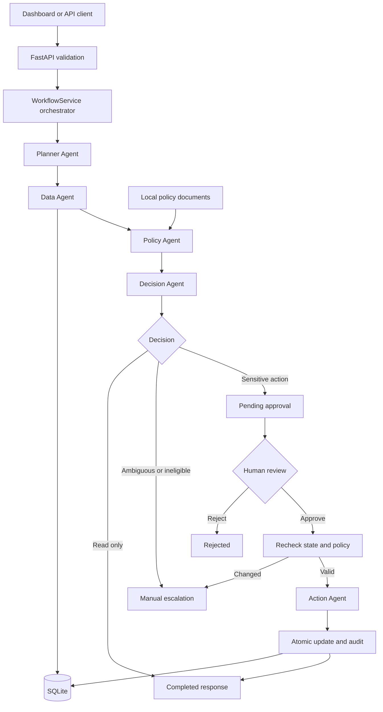
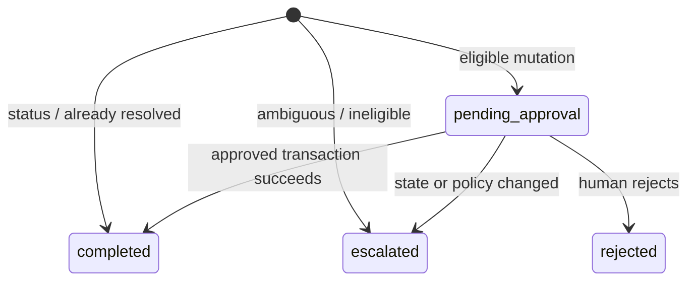

> Historical AgentFlow baseline documentation. Read the current root README and docs/phase2-verification.md for this checkpoint.

# Architecture and data flow

## Stored state

| Table | Purpose |
|---|---|
| orders | Synthetic business records, payment state, integer amount and version |
| workflows | Request, intent, mode, decision, evidence, original order snapshot and policy hash |
| events | Ordered agent activities, decisions and execution evidence |
| approvals | Exactly one review per resolved approval workflow |
| jobs | Persisted execution state, request key, cancellation flag and restart outcome |
| job_events | Ordered start/completion events for streaming, reconnect and replay |
| refunds | Unique simulated refund per order and workflow |

## State transitions

If a transaction fails, the pending state remains. A human can retry after resolving the underlying error. A bounded local worker queue handles live runs and reviews; automatic retry is not implemented.

## Trust boundaries

- Browser input is validated by Pydantic; extra fields are rejected.
- Customer text is data. It cannot select arbitrary tools or grant approval.
- Gemini output is advisory; deterministic code makes eligibility decisions.
- Data access is parameterised. Business tool names come from fixed allowlists.
- Every mutation rechecks the current order and policy, then commits atomically.
- Reviewer identities are not authenticated in this local prototype.
- Logs are persistent but not tamper-proof; an administrator can edit the database.

## Live execution path

The dashboard submits to `POST /api/jobs`. JobManager persists the accepted request, reserves one of eight outstanding slots, and schedules work on a two-thread executor. WorkflowService emits progress callbacks before and after each stage. JobManager writes those events to SQLite immediately. FastAPI streams them from `/api/jobs/{id}/events`, and the browser updates the map and inspector.

The workflow audit and the execution trace are distinct: the audit records business decisions and committed actions; the trace includes transient starts, durations and interruptions. Event IDs allow reconnect without duplicated display. The browser stores the active job ID locally; SQLite remains the source of truth.

Approval jobs use the existing atomic review service. Once a review begins, cancellation is not allowed. In-process background workers are not a distributed task system. Use one server process; orphaned jobs become interrupted on startup and require human inspection before retry.

## Document RAG (v0.7)

| Stage | Implementation |
|---|---|
| Ingestion | TXT/Markdown UTF-8 decoding or pypdf extraction, max 2 MB / 40 pages / 60,000 characters |
| Chunking | Up to 900 characters, 140-character overlap, document IDs and page metadata |
| Embeddings | Gemini batchEmbedContents with document/query task types, 768 dimensions, normalized vectors |
| Vector storage | Chroma PersistentClient, cosine metric, explicit vectors, no automatic model download |
| Retrieval | Query embeddings against active chunk IDs; deleted/stale chunks excluded |
| Generation | Gemini receives question + retrieved excerpts; no tools, source ID/quote checks |
| Business integration | Policy Agent retrieves curated policy context; Decision Agent generates a cited explanation; deterministic eligibility and human approval remain authoritative |

Chunks/documents/generated-answer records live in `data/rag/documents.sqlite3`; vectors live in `data/rag/chroma`. The collection name includes an embedding-model/dimension fingerprint, preventing accidental mixing of incompatible vector spaces. Uploads are idempotent by content digest. Indexing writes batches incrementally; a failed index can be retried, and unindexed active chunks prevent full-corpus Q&A until indexed.

Supplementary uploaded documents never become governing business rules. Original order snapshots, approvals and action transactions remain in `data/agentflow.db`.
